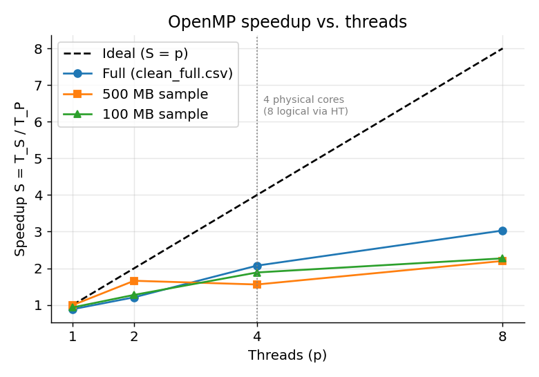
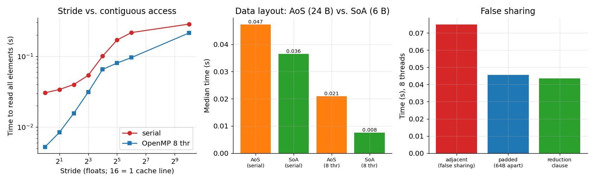

# SW 401 – Parallel & Distributed Systems: Phase 1 (Parallel Foundations)

Spatial and time-series analytics plus fare-per-mile anomaly detection on **23.59 million NYC TLC Yellow Taxi trip records** (Jan–Aug 2023), implemented in C++17 with a verified sequential baseline and OpenMP shared-memory parallelization.

---

## Repository Structure

```text
SW401-Project/
├── preprocessing/
│   ├── preprocess.py               # Automated download, cleaning, CSV export & sampling
│   └── preprocessing_summary.txt   # Exact before/after record counts and file sizes
├── src/
│   ├── common.h                    # SoA data model, 64B-aligned Bin struct, fast CSV loader
│   ├── sequential.cpp              # Verified sequential baseline (T_S) + --selftest
│   ├── parallel_omp.cpp            # OpenMP scaling, scheduling, sync & cache experiments
│   └── verify_baseline.py          # Independent Python/pandas verification against C++
├── data/                           # Generated locally (CSVs/Parquets excluded via .gitignore)
├── plots/
│   ├── run_experiments.ps1         # Windows end-to-end compile, benchmark & plot runner
│   ├── make_plots.py               # Generates PNG figures and CSV summary tables
│   ├── benchmark_summary.csv       # Scaling table (T_S, T_P, Speedup, Efficiency, serial f)
│   ├── schedule_summary.csv        # Static / dynamic / guided chunk-size timings
│   ├── sync_cache_summary.csv      # Sync & memory-hierarchy timings
│   └── *.png                       # Publication plots embedded in report.pdf
├── report_draft.md                 # Complete Phase 1 Markdown report source
└── report.pdf                      # Final 7-page Phase 1 PDF report
```

---

## Dataset & Preprocessing

Raw data comes from the official NYC TLC Yellow Taxi Parquet files (`yellow_tripdata_2023-01.parquet` through `yellow_tripdata_2023-08.parquet`). Because large `.parquet` and `.csv` files are excluded from Git via `.gitignore`, reproduce the dataset locally by running:

```bash
pip install pandas pyarrow numpy matplotlib
python preprocessing/preprocess.py
```

### Before & After Statistics (`preprocessing/preprocessing_summary.txt`)

| Dataset | Records | Size | Notes |
| :--- | :---: | :---: | :--- |
| **Raw Input (8 Parquet files)** | 25,224,937 | 415.9 MB | Compressed Parquet |
| **Cleaned Full (`data/clean_full.csv`)** | **23,592,248** | **809.5 MB (0.810 GB)** | 93.53% retained; 8 numeric cols, `\n` line endings |
| **500 MB Sample (`data/sample_500mb.csv`)** | 14,570,340 | 500.0 MB | Fixed-seed (`401`) Bernoulli subset |
| **100 MB Sample (`data/sample_100mb.csv`)** | 2,914,997 | 100.0 MB | Nested fixed-seed (`401`) Bernoulli subset |

---

## Build, Verification & Execution

### Windows (PowerShell + MinGW-w64 `g++`)
Run the full automated compile, self-test, benchmark, and plotting pipeline:

```powershell
powershell -ExecutionPolicy Bypass -File plots\run_experiments.ps1
```

Or compile and verify manually:

```powershell
mkdir bin, results -Force | Out-Null
g++ -O3 -fopenmp -std=c++17 src/sequential.cpp   -o bin/sequential.exe
g++ -O3 -fopenmp -std=c++17 src/parallel_omp.cpp -o bin/parallel_omp.exe

.\bin\sequential.exe --selftest
.\bin\sequential.exe data/sample_100mb.csv 5 results/seq_results_100mb.csv
python src/verify_baseline.py data/sample_100mb.csv results/seq_results_100mb.csv
```

### Linux (GCC + `perf stat` / `gprof`)

```bash
mkdir -p bin results
g++ -O3 -fopenmp -std=c++17 src/sequential.cpp   -o bin/sequential
g++ -O3 -fopenmp -std=c++17 src/parallel_omp.cpp -o bin/parallel_omp

./bin/sequential --selftest
./bin/sequential data/clean_full.csv 5 results/seq_results_full.csv
./bin/parallel_omp data/clean_full.csv all 5

# Profiling with perf stat & gprof
perf stat ./bin/parallel_omp data/clean_full.csv cache 3
g++ -O2 -fopenmp -pg -std=c++17 src/parallel_omp.cpp -o bin/parallel_omp_pg
./bin/parallel_omp_pg data/sample_100mb.csv all 3 > /dev/null
gprof ./bin/parallel_omp_pg gmon.out | head -n 60
```

---

## Phase 1 Key Results

Evaluated on an **Intel Core i7-6700HQ @ 2.60 GHz** (4 physical cores / 8 logical threads, 256 KB L2/core, 6 MB L3, 16 GB RAM, median of 5 runs after warm-up) and cross-profiled on a **Kali Linux VM** (4 vCPUs):

### 1. OpenMP Scaling (`clean_full.csv`, 23,592,248 records, $T_S = 0.154284\text{ s}$)

| Threads ($p$) | Median $T_P$ (s) | Speedup ($S = T_S/T_P$) | Efficiency ($E = S/p$) | Serial Fraction ($f$) |
| :---: | :---: | :---: | :---: | :---: |
| 1 | 0.174602 | 0.8836 | 0.8836 | — |
| 2 | 0.127677 | 1.2084 | 0.6042 | 0.6551 |
| 4 | 0.074436 | 2.0727 | 0.5182 | 0.3099 |
| **8** | **0.050904** | **3.0309** | **0.3789** | **0.2342** |

### 2. Synchronization, Scheduling & Memory Hierarchy Highlights
- **Synchronization (8 threads, `sample_100mb.csv`):** Thread-local `Bin[6384]` arrays + parallel merge (`0.008185 s`) outperformed `#pragma omp atomic` (`0.048242 s`, $5.89\times$ slower) and `#pragma omp critical` (`0.531056 s`, $64.88\times$ slower).
- **Scheduling (8 threads, `clean_full.csv`):** `guided` with `chunk=4096` achieved the lowest median time (`0.042929 s`), slightly ahead of `static` default (`0.043791 s`), while fine-grained `chunk=64` degraded both `static` (`0.078344 s`) and `dynamic` (`0.068946 s`).
- **Memory Hierarchy (`clean_full.csv`):**
  - *Strided access:* `stride=1024` slowed traversal by $9.30\times$ serially (`0.030459 s` $\to$ `0.283336 s`) and $40.63\times$ on 8 threads (`0.005242 s` $\to$ `0.212971 s`).
  - *Layout (AoS 24 B vs. SoA 6 B):* SoA improved 8-thread performance by $2.76\times$ on Windows (`0.020891 s` $\to$ `0.007563 s`) and $2.42\times$ on Linux (`0.022441 s` $\to$ `0.009281 s`).
  - *False sharing (40M iters, 8 threads):* 64B-padded counters (`0.045520 s`) and `reduction(+:tot)` (`0.043567 s`) avoided the cache-line invalidation penalty of adjacent counters (`0.074967 s`).
- **Linux Profiling (`perf stat` & `gprof`):** `perf stat` recorded `15,228.30 msec` `task-clock`, `50,034` context switches, and `89,559` page faults (`8.8727 s` elapsed); `gprof` confirmed sequential CSV I/O (`load_csv`, `0.27 s`) is $13.5\times$ slower than sequential compute (`aggregate_serial`, `0.02 s`) on `sample_100mb.csv`.




Full analysis, tables, and plots are available in [`report.pdf`](report.pdf) and [`report_draft.md`](report_draft.md).
