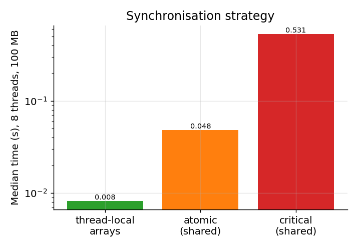
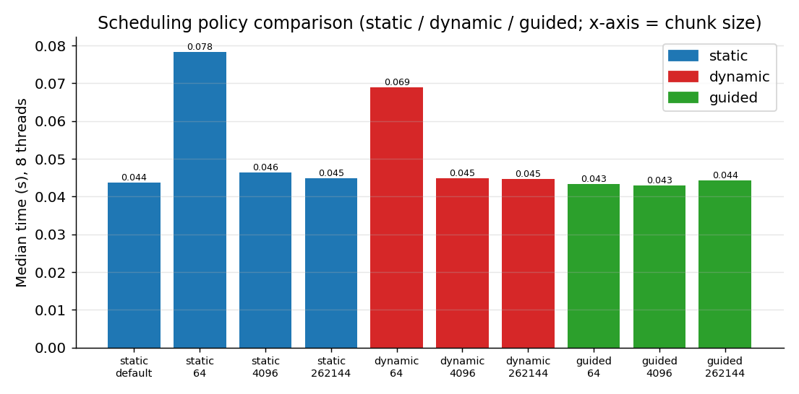
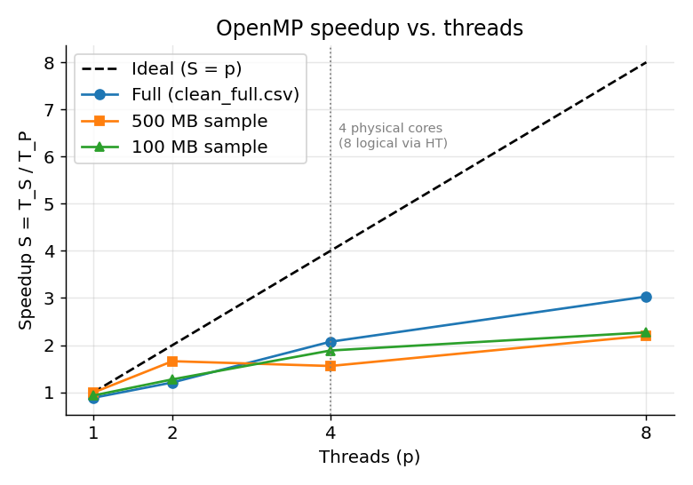
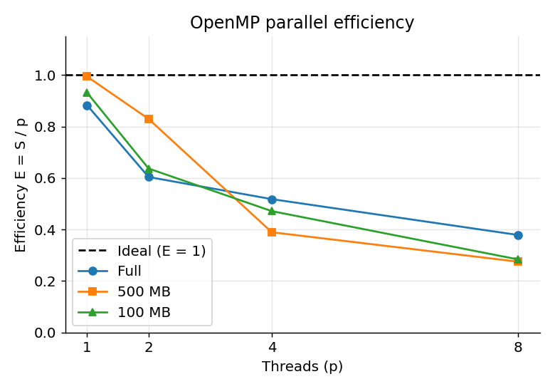
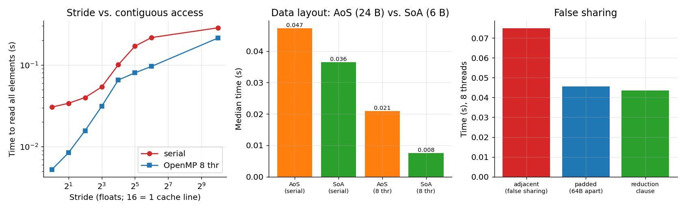

# SW 401 – Parallel and Distributed Systems (Fall 2025)
# Phase 1 Report: Parallel Foundations (Shared-Memory OpenMP)

**Domain:** Spatial & Time-Series Analytics + Anomaly Detection on NYC TLC Yellow Taxi Trip Data  
**Target Platform:** Intel Core i7-6700HQ @ 2.60 GHz (4 physical cores, 8 logical threads via Hyper-Threading; 256 KB L2/core, 6 MB shared L3; 16 GB RAM), Windows 11, GCC/MinGW-w64 16.2.0 (`-O3 -fopenmp -std=c++17`)

---

## 1. Dataset Description, Source, and Preprocessing

### 1.1 Source & Scale Justification
We use the official **New York City Taxi and Limousine Commission (NYC TLC) Yellow Taxi Trip Records** published on CloudFront (`yellow_tripdata_2023-01.parquet` through `yellow_tripdata_2023-08.parquet`, covering January–August 2023). Each record represents an independent taxi trip with pickup/dropoff timestamps, TLC Taxi Zone IDs (`1..265`), passenger count, distance, and fare/tip/revenue components. Because every trip record is self-contained and commutative under aggregation, the dataset cleanly satisfies the Phase 1 parallelism and line-based CSV requirements (and prepares cleanly for Phase 2 MPI and Phase 3 Hadoop MapReduce).

### 1.2 Preprocessing Pipeline (`preprocessing/preprocess.py`)
The raw monthly files are distributed as compressed Apache Parquet files (totaling **25,224,937 records** across **415.9 MB** compressed). Our reproducible Python script (`preprocessing/preprocess.py`) performs the following steps:

1. **Automated Download:** Fetches the 8 monthly Parquet files for Jan–Aug 2023 from the official NYC TLC CloudFront endpoint into `data/raw/`.
2. **Column Projection & Null Filtering:** Loads the 9 required columns (`tpep_pickup_datetime`, `tpep_dropoff_datetime`, `PULocationID`, `DOLocationID`, `passenger_count`, `trip_distance`, `fare_amount`, `tip_amount`, `total_amount`) and drops any row containing null/NaN values (**701,524** rows removed).
3. **Domain & Validity Filtering:**
   - Removes non-positive distances, fares, totals, passenger counts, or negative tips (`trip_distance <= 0`, `fare_amount <= 0`, `total_amount <= 0`, `passenger_count <= 0`, `tip_amount < 0`): **929,892** rows removed.
   - Parses timestamps and removes records where `tpep_dropoff_datetime <= tpep_pickup_datetime` or the pickup timestamp falls outside the file's month/year: **1,019** rows removed.
   - Validates `PULocationID` and `DOLocationID` in `1..265`: **0** rows removed.
   - Removes physically implausible GPS/meter outliers (`trip_distance >= 1000` miles): **254** rows removed.
4. **Feature Extraction & Compact Numeric CSV Export:** Extracts `pickup_hour` (`0..23`) from `tpep_pickup_datetime`, rounds monetary/distance fields to 2 decimal places, and exports 8 purely numeric columns (`PULocationID,DOLocationID,pickup_hour,passenger_count,trip_distance,fare_amount,tip_amount,total_amount`) using Unix line endings (`lineterminator='\n'`) for direct compatibility with Linux, C++ fast parsing, and Phase 3 Hadoop Streaming.
5. **Nested Subset Generation:** Generates `sample_100mb.csv` and `sample_500mb.csv` via fixed-seed (`seed=401`) Bernoulli sampling for rapid scaling and cross-phase comparison experiments.

### 1.3 Before & After Statistics (`preprocessing/preprocessing_summary.txt`)

| Metric | Raw Input (8 Parquet Files, Jan–Aug 2023) | Cleaned Full (`data/clean_full.csv`) | 500 MB Sample (`sample_500mb.csv`) | 100 MB Sample (`sample_100mb.csv`) |
| :--- | :---: | :---: | :---: | :---: |
| **Record Count** | 25,224,937 | **23,592,248** (93.53% retained) | 14,570,340 | 2,914,997 |
| **File Size** | 415,940,116 B (415.9 MB Parquet) | **809,535,908 B (0.810 GB CSV)** | 499,963,267 B (500.0 MB CSV) | 100,023,489 B (100.0 MB CSV) |
| **Format** | Compressed Parquet (19 columns) | Uncompressed CSV (`\n`, 8 numeric cols) | Uncompressed CSV (`\n`, 8 numeric cols) | Uncompressed CSV (`\n`, 8 numeric cols) |

*Note:* The cleaned full dataset contains **23.59 million records** (more than $2.3\times$ the 10-million-record project threshold) and expands to ~810 MB in compact 8-column numeric CSV format.

---

## 2. Problem Statement and Sequential Baseline Design

### 2.1 Analytical Problem Statement
For each `(PULocationID, pickup_hour)` pair ($266 \times 24 = 6,384$ spatial-temporal bins), compute:
1. **Total trips** ($N_{z,h}$), **average trip distance**, **total base fare**, **total revenue** (`total_amount`), and **average tip percentage** ($100 \times \text{tip} / \text{fare}$).
2. **Hard fare-per-mile anomalies (global):** Trips with $\text{fare}/\text{distance} > \$100/\text{mile}$, plus the global maximum fare-per-mile.
3. **Statistical z-score anomalies (Pass 2, per bin):** Trips whose fare-per-mile exceeds $\mu_{z,h} + 3\sigma_{z,h}$ within any bin having $N_{z,h} \ge 30$ trips.

### 2.2 Sequential Implementation (`src/sequential.cpp`, `src/common.h`)
- **Structure-of-Arrays (SoA) Memory Layout:** Instead of an Array-of-Structures (`Row` structs), `Data` stores contiguous `std::vector` columns (`bin`, `dist`, `fare`, `tip`, `total`). Pass 1 reads all 5 vectors sequentially; Pass 2 streams only `bin`, `dist`, and `fare`.
- **Two-Pass Execution:**
  - *Pass 1:* Accumulates per-bin sums (`trips`, `sum_dist`, `sum_fare`, `sum_total`, `sum_tippct`, `sum_fpm`, `sum_fpm2`) and global `hard_anomalies` / `max_fpm`.
  - *Threshold Calculation:* Computes $\mu_{z,h} + 3\sigma_{z,h}$ across the 6,384 bins (negligible cost, $<0.1$ ms).
  - *Pass 2:* Scans records again and increments `bins[bin[i]].anomalies` whenever `fare/dist > threshold[bin[i]]`.
- **Cache-Line Aligned Bins:** Each `Bin` struct uses `alignas(64)` (64 bytes, one cache line) so neighboring bins do not share a cache line. Total bin table size is $6,384 \times 64\text{ B} \approx 408.6\text{ KB}$, fitting inside the 6 MB L3 cache.
- **Benchmarking Protocol:** A custom byte-buffered CSV parser loads the file into RAM once (excluded from compute $T_S$), executes 1 warm-up pass so pages and caches are resident, and records the **median** of 5 timed repetitions.

### 2.3 Correctness Verification & Baseline Outputs
1. **Known-Answer Self-Test (`sequential.exe --selftest`):** Verifies hand-computed trips, averages, revenue, tip%, hard anomaly count, max fare-per-mile, and z-score anomalies (`SELFTEST,PASS`).
2. **Conservation Invariant:** Checks $\sum_{z,h} \text{trips}_{z,h} = N_{\text{rows}}$ on every dataset (`INVARIANT,sum_of_bin_trips==rows,PASS`).
3. **Independent Reference Check (`src/verify_baseline.py`):** Recomputes all 4,872 active bins of `sample_100mb.csv` in Python/pandas and compares against `results/seq_results_100mb.csv`. All 6 continuous/integer metrics matched within floating-point tolerance (`max_rel_diff` $\le 4.80 \times 10^{-7}$), and anomaly counts matched identically (`6,618` vs `6,618`, `abs_diff_sum=0`, `VERIFICATION PASS`).
4. **Full Dataset Baseline Output:** Across **5,808** active `(zone, hour)` bins and **23,592,248** trips, total base fare is **\$460,207,047.62**, total revenue is **\$674,674,397.89**, with **51,792** hard anomalies, **26,484** z-score anomalies, and a maximum fare-per-mile of **\$257,989.08**.

**Sequential Baseline Runtimes ($T_S$, median of 5 runs):**
- `clean_full.csv` (23.59M rows): **$T_S = 0.154284\text{ s}$** (Pass 1: `0.118015 s`, Pass 2: `0.036082 s`; CSV load: `1.8424 s`)
- `sample_500mb.csv` (14.57M rows): **$T_S = 0.103332\text{ s}$** (Pass 1: `0.078504 s`, Pass 2: `0.024588 s`)
- `sample_100mb.csv` (2.91M rows): **$T_S = 0.020875\text{ s}$** (Pass 1: `0.016127 s`, Pass 2: `0.004536 s`)

---

## 3. Parallelization Approach and OpenMP Directives

### 3.1 Race-Free Parallel Design (`src/parallel_omp.cpp`)
Direct concurrent updates to a shared `bins[6384]` array cause data races. Rather than guarding updates with locks, our primary parallel design (`LOCAL` mode) uses **thread-private bin arrays + parallel reduction merge**:

- **Pass 1 (`#pragma omp parallel num_threads(T) reduction(+:hard) reduction(max:maxf)`):**
  - Each thread allocates and first-touches its own private `std::vector<Bin>` of 6,384 bins ($T \times 408.6\text{ KB} \le 3.27\text{ MB}$ for $T=8$, fitting comfortably in the 6 MB L3 cache).
  - The trip loop uses `#pragma omp for schedule(runtime)` so `static`, `dynamic`, and `guided` policies can be benchmarked cleanly without recompiling.
  - Global scalar `hard_anomalies` and `max_fpm` use native OpenMP `reduction(+:hard)` and `reduction(max:maxf)` clauses.
- **Parallel Merge (`#pragma omp parallel for num_threads(T) schedule(static)`):**
  - After the trip loop, threads merge the $T$ private arrays in parallel across the 6,384 bins. Because each bin $k$ is owned by a single thread, no synchronization or atomics are needed.
- **Pass 2:** Uses the same pattern with thread-private `uint64_t` anomaly counters (`6384 * 8 B = 51 KB` per thread) followed by a static parallel merge across bins.

Every parallel configuration (`T = 1, 2, 4, 8`, all 10 scheduling configs, and all 3 synchronization modes) was verified against `aggregate_serial()` via `compare_results()`, passing with **`mismatched_bins=0`**.

### 3.2 Synchronization Strategy Comparison (8 threads, `sample_100mb.csv`)
To quantify why avoiding heavy synchronization matters (Labs 4–5), we benchmarked three synchronization strategies on 8 threads:

| Synchronization Strategy | Implementation | Median Time (s) | Slowdown vs. Thread-Local |
| :--- | :--- | :---: | :---: |
| **Thread-Local Arrays + Merge** | Private `Bin[6384]` per thread, lock-free merge | **0.008185** | $1.00\times$ (baseline) |
| **Fine-Grained Atomics (`atomic_shared`)** | 7 `#pragma omp atomic` updates on shared `bins[B[i]]` | **0.048242** | $5.89\times$ slower |
| **Coarse Critical Section (`critical_shared`)** | `#pragma omp critical(bins_update)` around bin update | **0.531056** | $64.88\times$ slower |

`critical_shared` serializes all 8 threads behind a single global mutex per trip ($64.9\times$ slower). `atomic_shared` improves concurrency across different bins, but high-volume pickup zones (e.g., zones 132, 161, 237) still cause heavy cache-line ping-ponging across cores ($5.9\times$ slower than thread-local arrays).

### 3.3 Scheduling Policy Comparison (8 threads, `clean_full.csv`)

| Schedule | Chunk Size | Median Time (s) | Notes |
| :--- | :---: | :---: | :--- |
| `static` | default ($N/8$) | 0.043791 | Minimal dispatch overhead; slight Hyper-Threading / OS jitter |
| `static` | 64 | 0.078344 | High round-robin scheduling & stride/cache disruption ($1.79\times$ slower than `static` default) |
| `static` | 4096 | 0.046366 | Good balance of contiguous chunks |
| `static` | 262144 | 0.044829 | Nearly identical to default static |
| `dynamic` | 64 | 0.068946 | Central work-queue contention across ~368k chunks |
| `dynamic` | 4096 | 0.044794 | Queue overhead amortized (~5,760 chunks) |
| `dynamic` | 262144 | 0.044714 | Low queue overhead (~90 chunks) |
| `guided` | 64 | 0.043337 | Large initial chunks + fine tail balancing |
| **`guided`** | **4096** | **0.042929** | **Best overall** (amortized queue + tail balancing across HT cores) |
| `guided` | 262144 | 0.044367 | Similar to static default |

**Analysis:** Because each trip performs nearly uniform arithmetic work, fine-grained chunking (`chunk=64`) hurts both `static` (destroys contiguous hardware prefetching across 8 threads) and `dynamic` (368,628 atomic queue pulls). Coarse `static (default)` (`0.0438 s`) and **`guided (4096)`** (`0.0429 s`) perform best; **`guided (4096)`** wins marginally because Hyper-Threading pairs and OS background noise introduce slight execution-rate asymmetry between logical threads, which `guided` absorbs cleanly at the tail without paying `dynamic(64)`'s queue overhead.

---

## 4. Performance Results and Scaling Analysis

All scaling experiments were run 5 times per thread count ($p \in \{1, 2, 4, 8\}$) after a warm-up pass, reporting the **median** runtime $T_P$. Speedup is $S = T_S / T_P$, efficiency is $E = S / p$, and estimated serial fraction (Karp–Flatt metric) is $f = \frac{1/S - 1/p}{1 - 1/p}$ for $p > 1$.

### 4.1 Scaling Tables (`plots/benchmark_summary.csv`)

#### Full Dataset (`clean_full.csv`, 23,592,248 records, $T_S = 0.154284\text{ s}$)
| Threads ($p$) | Median $T_P$ (s) | All 5 Runs (s) | Speedup ($S$) | Efficiency ($E$) | Serial Fraction ($f$) |
| :---: | :---: | :---: | :---: | :---: | :---: |
| **1** | 0.174602 | 0.2522, 0.1705, 0.1698, 0.1772, 0.1746 | 0.8836 | 0.8836 | — |
| **2** | 0.127677 | 0.1334, 0.1326, 0.0974, 0.1223, 0.1277 | 1.2084 | 0.6042 | 0.6551 |
| **4** | 0.074436 | 0.0736, 0.0749, 0.0586, 0.0750, 0.0744 | 2.0727 | 0.5182 | 0.3099 |
| **8** | 0.050904 | 0.0509, 0.0546, 0.0542, 0.0502, 0.0489 | **3.0309** | 0.3789 | 0.2342 |

#### 500 MB Sample (`sample_500mb.csv`, 14,570,340 records, $T_S = 0.103332\text{ s}$)
| Threads ($p$) | Median $T_P$ (s) | Speedup ($S$) | Efficiency ($E$) | Serial Fraction ($f$) |
| :---: | :---: | :---: | :---: | :---: |
| **1** | 0.103888 | 0.9946 | 0.9946 | — |
| **2** | 0.062265 | 1.6596 | 0.8298 | 0.2051 |
| **4** | 0.066320 | 1.5581 | 0.3895 | 0.5224 |
| **8** | 0.046959 | **2.2005** | 0.2751 | 0.3765 |

#### 100 MB Sample (`sample_100mb.csv`, 2,914,997 records, $T_S = 0.020875\text{ s}$)
| Threads ($p$) | Median $T_P$ (s) | Speedup ($S$) | Efficiency ($E$) | Serial Fraction ($f$) |
| :---: | :---: | :---: | :---: | :---: |
| **1** | 0.022393 | 0.9322 | 0.9322 | — |
| **2** | 0.016381 | 1.2743 | 0.6372 | 0.5694 |
| **4** | 0.011067 | 1.8862 | 0.4716 | 0.3735 |
| **8** | 0.009191 | **2.2712** | 0.2839 | 0.3603 |

### 4.2 Speedup and Efficiency Plots

---

## 5. Amdahl's Law, Gustafson's Law, Memory Hierarchy, and Profiling

### 5.1 Interpreting Scaling via Amdahl's and Gustafson's Laws
1. **Amdahl's Law ($S(p) = \frac{1}{f + (1 - f)/p}$):**
   At $p=8$ on the full dataset, we observe $S = 3.03\times$, corresponding to an effective serial fraction of $f = 0.234$. Under Amdahl's Law, this caps asymptotic speedup at $1/f \approx 4.27\times$ even with infinite cores. Crucially, the algorithmic serial part (`compute_thresholds()` over 6,384 bins + OpenMP fork/join barriers) takes well under $1\text{ ms}$ ($<1\%$ of $T_S$). The large *effective* $f \approx 0.23$ is therefore **not algorithmic serialization**—it is **shared DRAM memory bandwidth saturation** and **Hyper-Threading resource contention** across the 4 physical cores (when moving from $p=4$ to $p=8$, speedup rises only $1.46\times$, from $2.07\times$ to $3.03\times$, because logical threads share the same core execution pipelines and L1/L2 caches).
2. **Gustafson's Law ($S_{\text{scaled}}(p) = p - f(p - 1)$):**
   Comparing across dataset sizes at $p=8$ illustrates weak/problem-size scaling: the **100 MB** sample achieves $S=2.27\times$ ($E=28.4\%$) because a ~21 ms runtime cannot fully amortize OpenMP barrier/allocation overhead and thread-local array zeroing ($8 \times 408.6\text{ KB}$). Scaling up to the **Full 23.6M-record** dataset increases compute relative to fixed overhead, lifting speedup to **$S=3.03\times$ ($E=37.9\%$)**—consistent with Gustafson's observation that larger workloads amortize fixed parallel startup and reduction overheads.

### 5.2 Memory Hierarchy & Cache-Sensitive Experiments (`plots/sync_cache_summary.csv`)

1. **Strided vs. Contiguous Access (Spatial Locality & Hardware Prefetching):**
   Reading all `23,592,248` floats (`94.4 MB >> 6 MB L3`) with stride $s$ (visiting every element once across $s$ interleaved passes):
   - **Stride = 1 (contiguous):** `0.030459 s` (serial), **`0.005242 s`** (OpenMP 8 threads — $5.81\times$ parallel speedup).
   - **Stride = 16 (1 float per 64-byte cache line):** `0.100380 s` (serial, $3.30\times$ slower), `0.065255 s` (omp8, $12.45\times$ slower). Every 64B line fetched from DRAM yields only 4 useful bytes (93.75% bandwidth wasted).
   - **Stride = 1024 (4 KB page stride):** `0.283336 s` (serial, **$9.30\times$ slower**), `0.212971 s` (omp8, **$40.63\times$ slower**), causing both cache-line waste and TLB/prefetcher thrashing—and at stride 1024, 8 threads deliver almost no speedup ($1.33\times$) because DRAM latency/bandwidth is completely saturated.
2. **Data Layout — AoS (`24 B/row`) vs. SoA (`6 B/row` used):**
   Summing `fare` per `bin` requires only 6 bytes/record (`uint16_t bin` + `float fare`) out of a 24-byte `Row` struct:
   - **Serial:** AoS `0.047317 s` vs. SoA `0.036438 s` ($1.30\times$ faster).
   - **OpenMP 8 threads:** AoS `0.020891 s` vs. SoA **`0.007563 s`** (**$2.76\times$ faster**). Under 8-thread contention, SoA reduces DRAM bytes transferred by $4\times$, directly explaining why our main SoA implementation scales better than a struct-based layout.
3. **False Sharing (`40M` iterations, 8 threads):**
   - **Adjacent 8-byte counters** (sharing a 64B cache line -> MESI invalidation ping-pong): `0.074967 s`.
   - **128-byte padded counters** (isolated cache lines): `0.045520 s` ($1.65\times$ faster).
   - **OpenMP `reduction(+:tot)`** (register-resident accumulation): **`0.043567 s`** ($1.72\times$ faster).

### 5.3 Linux Performance Profiling (`perf stat` & `gprof` on Kali Linux VM)

To cross-validate memory hierarchy, OS scheduling, and hotspot behavior in a Linux/GCC environment, we compiled and profiled the codebase on a **Kali Linux VM** (4 virtual CPUs, `max_threads=4`, identical dataset checksum verified on all `23,592,248` rows: `total_fare=460207047.62`, `total_revenue=674674397.89`, `z_anomalies=26484`, `hard_anomalies=51792`).

#### A. `perf stat` & Cache-Sensitivity Profiling (`results/linux_perf_cache.log`)
Running `perf stat ./bin/parallel_omp data/clean_full.csv cache 3` inside the virtualized guest exposed kernel software performance counters (virtualized guest PMUs do not expose raw hardware `LLC-load-misses` counters without host PMU passthrough):

| `perf stat` Event / Metric | Measured Value | Interpretation |
| :--- | :---: | :--- |
| **`task-clock`** | `15,228.30 msec` | Total CPU time consumed across active threads (`1.72x` avg utilization over serial + parallel phases) |
| **`time elapsed` (wall)** | `8.8727 s` | End-to-end wall time (1.872 s CSV load + reference pass + 3 reps of all cache tests) |
| **`user` / `sys` time** | `13.5888 s` / `1.7061 s` | `88.8%` user-space compute; `11.2%` kernel I/O, page allocation, and thread scheduling |
| **`context-switches`** | `50,034` | Frequent preemption from running 8 OpenMP threads over 4 guest vCPUs (`2:1` oversubscription) |
| **`cpu-migrations`** | `7,579` | OS scheduler migrations across the 4 virtual cores |
| **`page-faults`** | `89,559` | Minor page faults from populating the 809.5 MB dataset SoA arrays and the temporary `AoS` buffer |

The accompanying Linux cache-sensitivity timings (`3` repetitions, median reported) reproduce the same memory-hierarchy effects observed on Windows, amplified by `4`-vCPU oversubscription:

| Experiment | Variant | Serial (s) | OpenMP 8 Threads (s) | Linux Locality / Contention Effect |
| :--- | :--- | :---: | :---: | :--- |
| **Stride (`float[]`)** | `stride = 1` (contiguous) | `0.032281` | `0.009720` | Full 64 B cache-line reuse + hardware prefetching (`3.32x` speedup on 4 vCPUs) |
| **Stride (`float[]`)** | `stride = 16` (1 float / 64 B) | `0.100126` | `0.065201` | $3.10\times$ slower serial, $6.71\times$ slower `omp8`; 93.75% of every fetched cache line discarded |
| **Stride (`float[]`)** | `stride = 64` | `0.225587` | `0.109930` | $6.99\times$ slower serial, $11.31\times$ slower `omp8` |
| **Stride (`float[]`)** | `stride = 1024` (4 KB page) | `0.303000` | `0.390223` | $9.39\times$ slower serial, $40.15\times$ slower `omp8` (TLB/cache thrashing + oversubscription) |
| **Data Layout** | `AoS` (24 B) vs. `SoA` (6 B) | `0.041635` vs. `0.026528` | `0.022441` vs. `0.009281` | SoA is **$1.57\times$ faster** serially and **$2.42\times$ faster** on 8 threads |
| **False Sharing** | `adjacent` / `padded` / `reduction` | — | `0.148047` / `0.110249` / `0.104311` | Eliminating cache-line bouncing yields $1.34\times$ (`padded`) to $1.42\times$ (`reduction`) speedup |

#### B. `gprof` Call-Graph & Hotspot Profile (`results/linux_gprof_summary.txt`)
Compiling with `-O2 -fopenmp -pg` and profiling `./bin/parallel_omp_pg data/sample_100mb.csv all 3` (`3.32 s` total sampled CPU time at `0.01 s` resolution) produced the following flat profile:

| Function / Symbol | % Time | Self (s) | Calls | Self ms/call | Role & Profiling Observation |
| :--- | :---: | :---: | :---: | :---: | :--- |
| **`frame_dummy`** *(libgomp / runtime)* | `83.00%` | `2.76` | `42` | `65.61` | Uninstrumented `libgomp` / outlined OpenMP worker execution mapped to nearest CRT symbol by `gprof` |
| **`load_csv(char const*, Data&)`** | `8.13%` | `0.27` | `1` | `270.05` | Single-threaded CSV disk I/O and ASCII-to-float parsing (`280.06 ms` total incl. children) |
| **`main`** | `7.83%` | `0.26` | — | — | Driver setup and benchmark harness (`3.06 s` cumulative incl. children) |
| **`aggregate_serial(...)`** | `0.60%` | `0.02` | `1` | `20.00` | Verified single-threaded compute baseline (`13.5x` faster than `load_csv` I/O!) |
| **`std::vector<float>::_M_realloc_append`** | `0.30%` | `0.01` | `4` | `2.50` | Minor vector growth during `load_csv` beyond initial `fsz / 36` estimate |

**Key Takeaway:** `gprof` confirms that sequential `load_csv` (`0.27 s`) takes **$13.5\times$ longer** than the entire sequential compute kernel `aggregate_serial` (`0.02 s`) on `sample_100mb.csv`, reinforcing the Windows observation (`1.84 s` load vs. `0.154 s` compute on `clean_full.csv`). It also illustrates a known limitation of `gprof` on OpenMP programs: `gprof` attributes samples inside dynamically linked `libgomp` worker threads to uninstrumented runtime stubs (`frame_dummy`) while `aggregate_omp` shows `0.00%` self time across `91` calls.

---

## 6. Reflection: Remaining Bottlenecks

1. **DRAM Memory Bandwidth Saturation:** Our arithmetic intensity is low (~12 FLOPs per 18 bytes streamed in Pass 1: `uint16_t` + 4 `float`s), placing the kernel firmly in the **memory-bound** regime on the Roofline model. Once 4 physical cores saturate the dual-channel DDR4 memory controller, adding logical threads (4 $\to$ 8) yields diminishing returns ($2.07\times \to 3.03\times$) and elevates the effective serial fraction $f$.
2. **Hyper-Threading (SMT) Resource Contention:** On the 4-core/8-thread i7-6700HQ, threads 5–8 share core execution units, L1/L2 caches, and load/store buffers with threads 1–4, explaining why parallel efficiency drops to 37.9% at $p=8$.
3. **Thread-Local Memory Footprint & Two-Pass I/O:** Replicating `Bin[6384]` across $T$ threads uses $T \times 408.6\text{ KB}$ (safe up to $T=8$, but would exceed L3 at $T=32+$ on larger servers without smaller bin structs or partitioning). Moreover, reading `clean_full.csv` from disk (`1.84 s`) takes **12$\times$ longer** than the sequential compute kernel (`0.154 s`), motivating distributed memory / partitioned storage in **Phase 2 (MPI)** and **Phase 3 (HDFS/MapReduce)** so both storage I/O and memory bandwidth scale across nodes.
